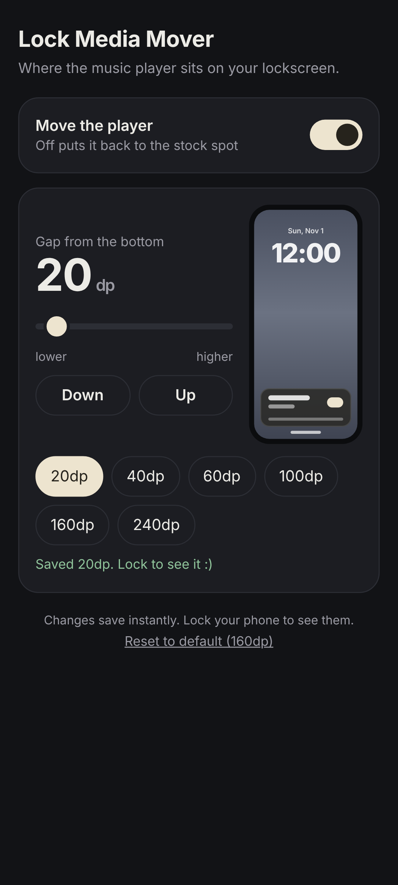

# Lock Media Mover

Small mod that moves the Android 16 lockscreen music player down, closer to iOS. The notifications slide up into the spot the player used to sit in, and the player drops to near the bottom.

It's a little personal thing I made for my own phone. I've only tested it on one device: a Xiaomi 11T Pro (vili) running InfinityX, Android 16, with Magisk and Vector. No idea how it behaves anywhere else, so treat it as "works on my phone" and go from there.

It's an LSPosed/Vector module shipped as a Magisk module.

## Requirements

- Android 16, on an AOSP-based ROM
- Root: Magisk, KernelSU or APatch
- LSPosed or Vector

## Install

1. Download the zip from [Releases](../../releases) and flash it in Magisk (or KernelSU / APatch)
2. Enable the module in LSPosed or Vector
3. Make sure System UI is ticked in its scope
4. Reboot

## Changing the position

The value is how far up the player sits, in dp. Bigger number, higher player. Below 0 turns it off and you get the stock layout back.

Three ways to change it:

- **Volume keys:** in Magisk, open the module and tap **Action**, then Vol+ to move it up and Vol- to move it down, 10dp per press. Going below 0 turns it off.
- **WebUI:** open the module's WebUI (KsuWebUI, MMRL or KernelSU). Slider, presets and an on/off switch.
- **Shell:**

```sh
su -c settings put secure lockmediamover_bottom_dp 40   # 40dp up
su -c settings put secure lockmediamover_bottom_dp -1   # off
```

## If it doesn't work

Check the LSPosed or Vector logs and search for `LockMediaMover:`. That'll tell you whether the hooks installed and whether it actually moved anything.

If System UI starts acting weird, disable the module in LSPosed/Vector, or boot into Magisk safe mode (hold volume down while the phone is booting).

## How it works

It hooks System UI's notification stack layout and rewrites the player's position right before it gets drawn, so System UI does the actual moving itself. There are fallbacks for R8-optimized builds where methods get inlined or renamed.

## Build

No Gradle. On Debian/Ubuntu:

```sh
sudo apt install openjdk-21-jdk aapt apksigner dalvik-exchange android-sdk-platform-23 zipalign zip
./build.sh
```

The Xposed API in `stubs/` is compile-only and doesn't get packaged. LSPosed provides the real one at runtime.

## WebUI


